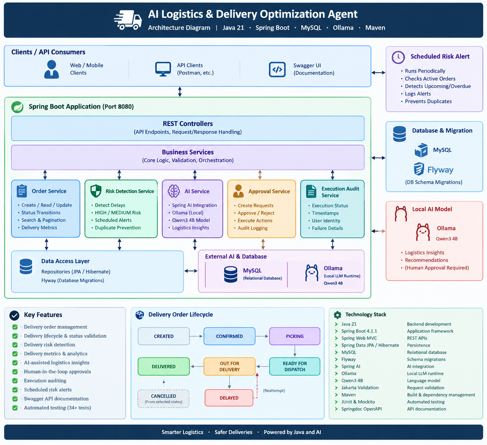

# AI Logistics & Delivery Optimization Agent

A Java-based logistics application that manages delivery orders, identifies delivery risks, generates AI-assisted logistics insights, and supports human-approved operational actions with execution auditing.

**Repository:** [GovindSharma22/ai-logistics-agent](https://github.com/GovindSharma22/ai-logistics-agent)

## Overview

Last-mile delivery operations need timely visibility into delivery status, potential delays, and operational actions. This project demonstrates how a Spring Boot backend can combine logistics business rules with a locally hosted language model and a human approval workflow.

The application uses deterministic Java logic for delivery metrics and status validation, while a local AI model provides logistics-oriented insights.

## Key Features

- **Delivery order management:** Create, retrieve, search, filter, and paginate delivery orders.
- **Delivery lifecycle management:** Validate status transitions and track delivery progress.
- **Delivery risk detection:** Identify orders approaching their estimated delivery time or already overdue.
- **Delivery metrics:** Calculate delivery statistics, including delivered orders, delayed orders, and on-time delivery rate.
- **AI-assisted insights:** Generate logistics insights using Spring AI and a local Ollama model.
- **Human-in-the-loop approvals:** Create, approve, or reject recommended operational actions before execution.
- **Execution auditing:** Record execution status, timestamps, user identity, and failure details.
- **Scheduled risk alerts:** Periodically detect delivery risks and log alerts with duplicate-alert prevention.
- **API documentation:** Explore endpoints through Swagger UI.
- **Automated testing:** Unit and web-layer tests using Maven and the project's test dependencies.

## Technology Stack

| Technology | Purpose |
|---|---|
| Java 21 | Backend development |
| Spring Boot 4.1.1 | Application framework |
| Spring Web MVC | REST APIs |
| Spring Data JPA / Hibernate | Persistence |
| MySQL | Relational database |
| Flyway | Database schema migrations |
| Spring AI | AI integration |
| Ollama | Local language-model runtime |
| Qwen3 4B | Local language model |
| Jakarta Validation | Request validation |
| Maven | Build and dependency management |
| JUnit and Mockito | Automated testing |
| Springdoc OpenAPI | API documentation |


## Architecture


The application follows a layered backend architecture.

```text
Clients / API Consumers
          |
          v
     REST Controllers
          |
          v
     Business Services
       /          \
      v            v
Repositories    Spring AI Service
      |            |
      v            v
    MySQL        Ollama
      |
      v
 Orders, Approvals,
 and Execution Audit
```

### Main modules

- **Order module:** Manages delivery orders, lifecycle transitions, search, pagination, and delivery metrics.
- **Risk detection module:** Identifies orders with upcoming or missed delivery estimates.
- **AI module:** Accepts logistics questions and produces AI-assisted recommendations and insights.
- **Approval module:** Manages approval requests, decisions, supported action execution, and execution audit records.
- **Scheduled alert module:** Periodically checks for delivery risks and logs alerts.

## Prerequisites

Install the following before running the application:

- JDK 21
- MySQL
- Ollama
- Git

The project includes Maven Wrapper scripts, so a separate Maven installation should not be necessary.

## Getting Started

### 1. Clone the repository

```bash
git clone https://github.com/GovindSharma22/ai-logistics-agent.git
cd ai-logistics-agent
```

### 2. Create the MySQL database and application user

Connect to MySQL using an administrative account and execute:

```sql
CREATE DATABASE logistics_agent;

CREATE USER 'logistics_app'@'localhost'
IDENTIFIED BY 'replace_with_a_strong_password';

GRANT ALL PRIVILEGES ON logistics_agent.*
TO 'logistics_app'@'localhost';
```

Use your own strong password. Never commit actual database credentials to Git.

The application uses Flyway to apply the versioned database migrations on startup.

### 3. Configure environment variables

The application supports these environment variables:

| Variable | Default / purpose |
|---|---|
| `DB_URL` | Defaults to `jdbc:mysql://localhost:3306/logistics_agent` |
| `DB_USERNAME` | Defaults to `logistics_app` |
| `DB_PASSWORD` | Must be provided securely |

For a local terminal session, configure them before starting the application:

```bash
export DB_URL="jdbc:mysql://localhost:3306/logistics_agent"
export DB_USERNAME="logistics_app"
export DB_PASSWORD="your_actual_local_password"
```

Do not put real credentials in this README or commit them to version control.

### 4. Install and start Ollama

Install Ollama from [ollama.com](https://ollama.com/).

Download the configured model:

```bash
ollama pull qwen3:4b
```

Ensure the Ollama service is running and accessible at:

```text
http://localhost:11434
```

The application is configured to use `qwen3:4b` through Spring AI.

### 5. Run the application

On macOS or Linux:

```bash
chmod +x mvnw
./mvnw spring-boot:run
```

On Windows:

```bat
mvnw.cmd spring-boot:run
```

The application is configured to use port `8080` by default.

### 6. Run automated tests

```bash
./mvnw test
```

The latest reported test run completed with **34 tests, zero failures, zero errors, and zero skipped tests**.

The test configuration uses an in-memory H2 database. Run the tests again against your current checkout to confirm the result.

## API Endpoints

The following endpoints cover the main implemented workflows. Request and response details can be inspected in the controllers and Swagger documentation.

### Delivery orders

| Method | Endpoint | Purpose |
|---|---|---|
| `POST` | `/api/orders` | Create a delivery order |
| `GET` | `/api/orders` | List and search orders |
| `GET` | `/api/orders/{id}` | Retrieve an order |
| `GET` | `/api/orders/status/{status}` | Filter orders by status |
| `GET` | `/api/orders/delayed` | Retrieve delayed orders |
| `GET` | `/api/orders/metrics` | Retrieve delivery metrics |
| `PATCH` | `/api/orders/{id}/status?status=...` | Update order status |
| `GET` | `/api/orders/risks` | Retrieve delivery-risk information |

### AI insights

| Method | Endpoint | Purpose |
|---|---|---|
| `POST` | `/api/ai/logistics-insights` | Generate logistics insights |

Example request:

```json
{
  "question": "Which deliveries need immediate attention?"
}
```

### Approval workflow

| Method | Endpoint | Purpose |
|---|---|---|
| `POST` | `/api/approvals` | Create an approval request |
| `GET` | `/api/approvals/pending` | Retrieve pending approvals |
| `GET` | `/api/approvals/orders/{orderId}` | View approval history for an order |
| `POST` | `/api/approvals/{id}/approve` | Approve a request |
| `POST` | `/api/approvals/{id}/reject` | Reject a request |
| `POST` | `/api/approvals/{id}/execute` | Execute a supported approved action |

The execution service validates the approval state and supported action before attempting execution. Failures are recorded in the execution audit fields.

### Swagger UI

When the application is running, open:

[http://localhost:8080/swagger-ui.html](http://localhost:8080/swagger-ui.html)

OpenAPI specification:

[http://localhost:8080/v3/api-docs](http://localhost:8080/v3/api-docs)

## Delivery Status Lifecycle

The application models delivery progress using these statuses:

```text
CREATED
   |
   v
CONFIRMED
   |
   v
PICKING
   |
   v
READY_FOR_DISPATCH
   |
   v
OUT_FOR_DELIVERY
   |              \
   v               v
DELIVERED        DELAYED
                    |
                    v
              OUT_FOR_DELIVERY
```

Cancellation is permitted from selected intermediate states. Invalid transitions are rejected by the business layer.

The exact transition rules are enforced by the order service rather than by the AI model.

## Delivery Risk Detection

The risk detection logic identifies active orders whose estimated delivery time is approaching or has already passed.

- **HIGH:** The estimated delivery time has passed and the order remains undelivered.
- **MEDIUM:** The order is within the configured upcoming-risk window.

The scheduled component periodically checks for risks and logs alerts. These alerts are application logs, not a claim of integrated SMS, email, or push notifications.

## AI and Human Approval

The AI integration supports logistics-oriented questions and recommendations using a locally hosted model.

The design separates AI-generated suggestions from deterministic business operations:

1. A logistics question is submitted to the AI endpoint.
2. The application obtains logistics data and generates insights.
3. An operational recommendation can be represented as an approval request.
4. A human approves or rejects the request.
5. Only supported actions can be executed after approval.
6. The execution outcome is recorded for auditing.

**Important:** AI-generated recommendations are not inherently correct. Validate operational decisions against application rules and actual logistics data before execution.

## Testing

Run the complete test suite:

```bash
./mvnw test
```

The test suite includes coverage for the AI controller, delivery-order services and controllers, repository behavior, scheduled risk alerts, and approval execution.

The project has a reported passing baseline of 34 tests. Test count and coverage may change as new features are added.

## Current Limitations

This repository is a prototype intended for learning, demonstration, and further development.

- Approval endpoints currently use a demonstration identity; production authentication and authorization need to be implemented.
- The execution workflow supports a specific operational action rather than arbitrary AI-generated actions.
- Scheduled alerts are logged by the application; external notification delivery is not implemented.
- The application has not yet been established as production-ready through deployment, security, load, and resilience testing.
- Operational recommendations should be reviewed by authorized users.

## Future Enhancements

- Add authentication and role-based authorization with Spring Security and JWT.
- Build a delivery operations dashboard.
- Add integration tests for the complete order and approval workflows.
- Introduce GitHub Actions for continuous integration.
- Add structured observability, metrics, and tracing.
- Improve resilience with retries, timeouts, and circuit breakers where appropriate.
- Expand delivery optimization with route, warehouse, and delivery-capacity constraints.
- Add notification integrations and stronger audit reporting.

## Author

**Govind Sharma**

Senior Java Backend Engineer | Java | Spring Boot | Microservices | REST APIs | System Design

GitHub: [GovindSharma22](https://github.com/GovindSharma22)

---

*Built as a practical demonstration of Java backend engineering, logistics workflows, local AI integration, and human-in-the-loop operational controls.*
